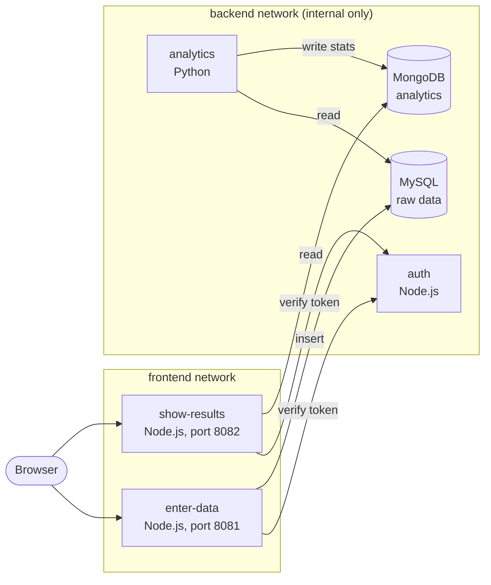

# ACIT3495 Project 1: Data Collection and Analytics System

A containerized microservices system. Authenticated users enter numeric data, a background service computes statistics (count, min, max, average), and a second web app shows the results.

**The Team:**

| Student | GitHub Username | Service Owned |
| --- | --- | --- |
| Luis Labao | @wiswisrocket | TODO |
| Joshua Domino | @joshdomino | TODO |
| Michael Mehram | @Dawningg | TODO |
| Katrina de Guzman | @katrinadeguzman | TODO |

## Architecture



The two web apps sit on both networks. Everything else is only on the internal `backend` network, so it has no published ports and cannot be reached from the host.

**Data flow**

1. A user logs in through either web app. The app forwards the credentials to `auth`, which checks them against a bcrypt hash in MySQL and returns a signed token. The token is stored in an `httpOnly` cookie.
2. `enter-data` validates the submitted number on the server and inserts it into MySQL.
3. `analytics` wakes every 30 seconds, reads MySQL, computes count/min/max/average (overall and per user) and writes the results to MongoDB.
4. `show-results` reads those results from MongoDB. Every request to either web app is verified with `auth`.

| Service | Language | Reachable from host | Job |
| --- | --- | --- | --- |
| enter-data | Node.js 20 | `localhost:8081` | Web app to enter data, writes to MySQL |
| show-results | Node.js 20 | `localhost:8082` | Web app to view analytics, reads MongoDB |
| auth | Node.js 20 | no | Validates logins, issues and verifies tokens |
| analytics | Python 3.12 | no | Computes statistics, writes to MongoDB |
| mysql | MySQL 8.4 | no | Raw data and user accounts |
| mongo | MongoDB 7 | no | Computed analytics |

## Quick start

**Needs:** Docker with Compose v2 (Docker Desktop is fine) and git.

```bash
git clone https://github.com/wiswisrocket/acit3495_project1
cd acit3495_project1
cp .env.example .env        # PowerShell: copy .env.example .env
# edit .env and replace every change_me (see Configuration below)
docker compose up -d --build
docker compose ps           # wait about a minute until every service is "healthy"
```

Then open:

- Enter Data: <http://localhost:8081>
- Show Results: <http://localhost:8082>

Log in with the `SEED_USERNAME` and `SEED_PASSWORD` you put in `.env`. Submit a few numbers, wait about 30 seconds, and the results page shows the statistics.

## Configuration

All configuration lives in `.env` (copied from `.env.example`). `.env` is gitignored and must never be committed.

- **Passwords:** use letters and digits only. They are inserted into the database init scripts.
- **`JWT_SECRET`:** any long random string, for example the output of `openssl rand -hex 32`.
- **`SEED_USERNAME` / `SEED_PASSWORD`:** the app login. Auth creates this user on startup if it does not exist. To add another user, change these two values and run `docker compose up -d auth`. There is no sign-up page.
- **Database accounts:** each service has its own MySQL or MongoDB account with only the privileges it needs. They are created once, the first time the data volumes are empty.

## Common commands

```bash
docker compose logs -f auth      # also: enter-data, show-results, analytics, mysql, mongo
docker compose down              # stop, keep data
docker compose down -v           # stop and DELETE all data (needed after changing DB passwords in .env)
docker compose up -d --build     # rebuild after pulling changes
```

## Repository layout

```text
acit3495_project1/
├── README.md
├── docker-compose.yml
├── .env.example
├── .gitignore
├── .gitattributes
├── .github/
│   └── workflows/
│       └── ci.yml
├── db/
│   ├── mysql/init.sh          # tables and one least-privilege account per service
│   └── mongo/init.sh          # writer account (analytics) and read-only account (show-results)
├── docs/
│   └── TEAM_GUIDE.md          # internal planning notes
└── services/
    ├── auth/                  # Dockerfile, .dockerignore, package.json, src/, tests/
    ├── enter-data/            # same, plus public/ (web UI)
    ├── show-results/          # same, plus public/ (web UI)
    └── analytics/             # Dockerfile, .dockerignore, requirements.txt, src/, tests/
```

## Design notes

**Networking.** Two Compose networks. `frontend` carries the published ports of the two web apps. `backend` is `internal: true`: MySQL, MongoDB, auth and analytics have no published ports, no host access and no outbound internet.

**Secrets and access control.**
- No secrets in the repository. Everything comes from `.env`.
- Separate database accounts: auth can read/insert `users`; enter-data can read/insert `measurements`; analytics can only read `measurements`; analytics writes MongoDB with a writer account; show-results reads MongoDB with a read-only account.
- Passwords are stored as bcrypt hashes. Tokens are HS256 JWTs valid for one hour, kept in an `httpOnly`, `SameSite=Strict` cookie.
- A username is locked for a few minutes after 10 failed logins.
- Input is validated on the server (username format, numeric range for values) and all SQL uses parameterized queries.

**Container hardening.** Non-root users, `cap_drop: ALL`, `no-new-privileges`, read-only root filesystems with a tmpfs `/tmp` for the application containers.

**Persistence.** Named volumes `mysql_data` and `mongo_data`. The init scripts only run when a volume is empty.

**Health and recovery.**
- Every service has a health check, and services start in dependency order using `depends_on: condition: service_healthy`. All use `restart: unless-stopped`.
- If a database is down, the web apps answer with a clean `503` instead of crashing, and recover on their own when it returns.
- `analytics` logs the failure and retries on the next cycle. It reports unhealthy if it has not completed a cycle for `max(3 x interval, 90s)`.

**Resources.** CPU and memory limits are set per service in `docker-compose.yml`, each with a comment giving the reason.

**Logs.** One JSON object per line, never containing passwords or tokens. Docker log rotation is capped at 3 files of 10 MB per container.

**Images.** Multi-stage builds, slim or Alpine base images, a `.dockerignore` per service, and multi-architecture (amd64 and arm64) images built in CI.

## Tests

No Docker needed:

```bash
cd services/auth && npm ci && npm test              # same for enter-data and show-results
cd services/analytics && pip install -r requirements.txt pytest && python -m pytest
```

## CI/CD

GitHub Actions (`.github/workflows/ci.yml`):

- **Every pull request:** unit tests for all four services, validation of `docker-compose.yml`, an image build for each service, and a Trivy vulnerability scan (HIGH and CRITICAL findings with a fix available).
- **Every push to `main`:** the same, then a multi-architecture build, tagging with the short commit SHA and `latest`, and publishing to GitHub Container Registry as `ghcr.io/<owner>/acit3495-<service>`.
- Trivy currently reports without failing the pipeline (`exit-code: "0"`). Change it to `"1"` to fail on findings.

## Evidence

TODO: the team fills these in after measuring the running system. Link the full details from the technical report.

| Area | Result |
| --- | --- |
| Docker optimization (image size and build time, before and after) | TODO |
| Vulnerability scan (what was found and what we did about it) | TODO |
| Failure tests (which services were stopped, what users saw, how it recovered) | TODO |
| Load test (throughput, errors, CPU, memory; two improvements compared with the baseline) | TODO |
| Persistence (data after recreating a database container) | TODO |
| Successful CI run (link) |  |

## AI assistance

The service code, Dockerfiles, Compose file, database init scripts and CI workflow were written with AI assistance (Claude). TODO: each owner notes what they reviewed or changed.
